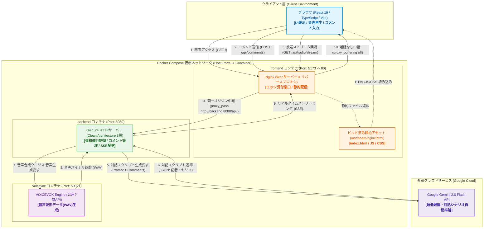

# システムアーキテクチャおよびインフラ設計書

本書は，AI Radio のシステムアーキテクチャ，インフラ設計思想，各技術選定の背景，および通信制御の仕組みを包括的にまとめた総合ドキュメントである．

---

## 1. 全体アーキテクチャ概要

本システムは，リスナーからのコメント投稿を受け付け，Google Gemini API による自然言語推論でラジオ番組の対話スクリプトを自律生成し，VOICEVOX Engine でキャラクター音声を合成してリアルタイム配信する Web アプリケーションである．
システムは Docker Compose により仮想ネットワーク上で統合され，独立したコンテナ群として稼働する．

### 1.1 サービス構成・通信フロー図



---

## 2. システムを構成

本システムを構成する各要素の役割分担を一般的な Web システムアーキテクチャの観点から整理する．

* **フロントエンドソースコード（`frontend/src/`）:**
  * ブラウザ上で動作するユーザーインターフェース（UI）およびクライアントロジックの実装．
  * React / TypeScript で記述され，Vite により事前に静的ファイル（HTML/JavaScript/CSS）へコンパイル・バンドルされる．
* **Nginx（`frontend` コンテナ）:**
  * 「エッジサーバー / リバースプロキシ兼静的ファイル配信Webサーバー」．
  * クライアントからの初回アクセスに対して静的アセットを返却し，`/api/` 宛の動的リクエストを内部バックエンドへ中継（プロキシ）する．
* **バックエンド（`backend` コンテナ / Go 1.24）:**
  * 「アプリケーションサーバー」．
  * コメント管理，Gemini API への対話シナリオ推論リクエスト構築，VOICEVOX Engine への音声合成要求，および SSE によるクライアントへのストリーミング送出を統括する．
* **Gemini API :**
  * 「外部 LLM 推論基盤（AI サービス）」．
  * 未読コメントや過去の文脈を元に，ラジオ DJ とゲストの自然な掛け合いスクリプトを JSON 形式で生成する．
* **VOICEVOX Engine（`voicevox` コンテナ）:**
  * 「内部マイクロサービス（音声合成エンジン）」．
  * バックエンドから渡されたテキストデータから音声特徴量を抽出し，キャラクター固有の音声波形データ（WAV）を生成する．
* **Docker / Docker Compose:**
  * 「コンテナ仮想化およびオーケストレーション基盤」．
  * 依存関係や実行環境の差異を排除し，独立した仮想ネットワーク上で各サービス間の名前解決と通信を保証する．

---

## 3. Nginx と Docker・各コードとの関係性

### 3.1 Nginx とは何か

Nginx は，軽量性と並行処理能力に特化した「Webサーバー（静的ファイル配信機）」兼「リバースプロキシ（通信の転送機）」である．
プログラムの計算処理（GoのビジネスロジックやReactのコンポーネント計算）は行わず，**「ファイルの配達」** と **「通信経路の整理」** に専念する．

### 3.2 フロントエンドコードとの関係

* `frontend/src/App.tsx` 等のソースコードは，そのままではブラウザで解釈できない．
* ビルド（`pnpm run build`）を実行することで，ブラウザが直接実行できる静的な `index.html`，JavaScript，CSS に変換され，`frontend/dist/` に出力される．
* 変換後のファイルは「単なるファイル」であるため，実行環境（Node.js）を稼働させ続ける必要はない．
* **Nginx は，この出来上がった `dist/` の静的ファイルをブラウザへ高速に届けるためだけに採用されている．**

### 3.3 バックエンドコードとの関係

* Go サーバーは独自の HTTP サーバー（ポート 8080）を持っており，直接ブラウザと通信することも技術的には可能である．
* しかし，ブラウザが画面用（ポート 5173）と API 用（ポート 8080）の2つの異なるポートと直接通信すると，セキュリティ上の制約（CORS）が発生する．
* Nginx が [frontend/nginx.conf](file:///home/yuma25/github/ai-radio/frontend/nginx.conf) に基づき，`/api/` へのアクセスを内部の `http://backend:8080/api/` へ代理転送（リバースプロキシ）する．
* これにより，ブラウザは「1つの窓口（ポート 5173）とだけ話せばよい状態」になり，通信構成が極めてシンプルになる．

### 3.4 Docker との関わり

[frontend/Dockerfile](file:///home/yuma25/github/ai-radio/frontend/Dockerfile) では **マルチステージビルド** を採用している．

1. **第1段階（Node.js 作業部屋）:**
   `node:24-alpine` 環境で `pnpm run build` を行い，静的ファイル（`dist/`）を生成する．
2. **第2段階（Nginx 本番部屋）:**
   第1段階で生成された `dist/` のファイル群と `nginx.conf` だけを `nginx:alpine` にコピーし，Node.js 環境そのものは破棄する．

この仕組みにより，イメージサイズを数百MBから数十MBへと削減し，脆弱性の混入リスクを最小限に抑えている．

---

## 4. リバースプロキシと CORS 設定の違い

ブラウザが異なるオリジン（ドメインやポート）へ通信する際の課題に対し，アプローチは2種類存在する．

```
【アプローチA: リバースプロキシ方式（本システム採用）】
ブラウザ ──(同一オリジン: 5173)──> Nginx ──(内部転送)──> Goバックエンド (8080)
※ ブラウザからは同一サーバーに見えるため，CORSの仕組み自体が発動しない．

【アプローチB: CORSヘッダー許可方式】
ブラウザ ──(別オリジン: 8080へ直電)──> Goバックエンド (8080)
※ バックエンドが「Access-Control-Allow-Origin: http://localhost:5173」を返して許可する．
```


| 比較項目           | リバースプロキシ方式（Nginx採用）                                   | CORSヘッダー許可方式（直アクセス）                                                  |
| :------------------- | :-------------------------------------------------------------------- | :------------------------------------------------------------------------------------ |
| **仕組み**         | 窓口を1本化し，裏で通信を中継する．                                 | ブラウザに「別ポートへのアクセスを許可する」ヘッダーを返す．                        |
| **ブラウザの認識** | 単一のサーバー（ポート 5173）と通信していると認識．                 | 2つの独立したサーバーと通信していると認識．                                         |
| **メリット**       | CORS エラーが原理的に発生しない．本番環境でドメインを統一しやすい． | リバースプロキシサーバー（Nginx等）を立てる必要がない．                             |
| **デメリット**     | Nginx 等の中継設定ファイルを用意・管理する必要がある．              | プリフライトリクエスト（OPTIONS通信）が毎回発生し，設定ミスで通信不能になりやすい． |

本システムでは，開発・本番ともに通信トラブルを防ぎ，SSE（Server-Sent Events）のバッファリング制御を一元管理するために，リバースプロキシ方式を採用している．

---

## 5. ローカル環境と本番環境動作環境

#### 開発環境（ローカル）

* `pnpm run dev` で Node.js が稼働する．
* コードを書き換えた瞬間に画面を更新する HMR（Hot Module Replacement）や TypeScript の即時トランスパイルを行うため，Node.js が必要となる．

#### 本番環境（Docker / Nginx / Vercel など）

* 事前にビルドされた時点で「純粋な HTML，JavaScript，CSS」という固定ファイルに変換済みである．
* したがって，本番で必要なのは「出来上がったファイルを要求に応じて送り返す機能」だけであり，Node.js ではなく Nginx や CDN のエッジサーバーで十分となる．

### 5.2 Next.js（SSR）と React（Vite SPA）の違い

* **React + Vite（本プロジェクト / CSR: クライアントサイドレンダリング）:**
  * 画面の組み立てはすべてリスナーの「ブラウザ内」で行われる．
  * サーバー側で Node.js を動かす必要がない．
* **Next.js / Nuxt（SSR: サーバーサイドレンダリング）:**
  * サーバー側で HTML を動的に組み立ててからブラウザへ返す．
  * この構成の場合のみ，本番環境でも Node.js（またはエッジランタイム）を常時稼働させる必要がある．

---

## 6. Webサーバー・プロキシ構成の代替選択肢比較

Nginx の代わりに採用し得る主要な選択肢，およびその特徴・クラウドデプロイ先との差異を整理する．


| 方式・ソフトウェア                                 | 具体的な良さ・メリット                                                                                                                                   | デプロイ先・運用面での差異                                                                                                             |
| :--------------------------------------------------- | :--------------------------------------------------------------------------------------------------------------------------------------------------------- | :--------------------------------------------------------------------------------------------------------------------------------------- |
| **Nginx**（本システム採用）                        | 世界中で最も利用されており，情報量・安定性が圧倒的．低メモリ消費で SSE 等のストリーミング制御も精密に記述できる．                                        | 自前で Docker コンテナや VPS，EC2 等のサーバーを管理する必要がある．                                                                   |
| **Caddy**                                          | 設定記述（Caddyfile）が直感的で非常に短い．Let's Encrypt による SSL/TLS 証明書の自動取得・更新が標準機能として組み込まれている．Go製で単一バイナリ動作． | Nginx に比べて大規模エンタープライズや複雑なチューニング事例がやや少ない．                                                             |
| **Traefik**                                        | Docker コンテナのラベルを監視し，ルーティングルールを動的に自動生成する．マイクロサービスや Kubernetes 環境での運用負荷が非常に低い．                    | 単純な単一Webアプリに対しては設定の抽象度が高く，学習コストがやや高い．                                                                |
| **Apache HTTP Server**                             | 歴史が長く信頼性が高い．`.htaccess` によるディレクトリ単位の動的制御が可能．モジュール群が極めて豊富．                                                   | イベント駆動型の Nginx に比べ，同時接続数が増加した際のメモリ消費が大きくなりやすい．                                                  |
| **Node.js サーバー**（serve, Express）             | フロントエンドと同じ JavaScript エコシステムで完結し，新たな設定言語を学ぶ必要がない．                                                                   | 本番環境で重い Node.js ランタイムを動かすことになり，コンテナサイズとメモリ使用量が無駄に増大する．                                    |
| **Go 内包**（`embed` パッケージ）                  | フロントエンドのビルド成果物を Go の単一実行バイナリ内に埋め込む．Nginx コンテナが不要になり，単一バイナリ・1コンテナで完結する．                        | フロントとバックの結合度が上がり，片方だけをデプロイし直すといった運用の柔軟性が低下する．                                             |
| **クラウド / CDN**（Vercel, Cloudflare Pages, S3） | 自前でコンテナやサーバーを動かさず，世界中に分散配置されたエッジキャッシュから配信する．ゼロ管理・自動スケール・最高峰の配信速度が得られる．             | ローカルの Docker Compose 環境と構成が一致しないため，「ローカルでは Nginx，本番では CDN」のように環境差異を意識した設計が求められる． |

---

## 7. バックエンド・フロントエンドのクリーンアーキテクチャ全8層構造

本リポジトリは，保守性とテスタビリティを最大化するため，フロントエンド・バックエンド双方に対称的な8層のクリーンアーキテクチャを採用している．

### 7.1 バックエンド（Go 1.24）全8層

|  層番号  | レイヤ名          | ディレクトリ                  | 責務と依存ルール                                                               |
| :---------: | :------------------ | :------------------------------ | :------------------------------------------------------------------------------- |
| **第1層** | Domain Model      | `internal/01_domain_model/`      | システムの中核エンティティと絶対のビジネスルール．外部パッケージ依存厳禁．     |
| **第2層** | Domain Repository | `internal/02_domain_repository/` | UseCase が求めるデータ永続化や外部通信の契約インターフェース．                 |
| **第3層** | UseCase           | `internal/03_usecase/`           | ラジオ放送進行，コメント受付等の業務手順シナリオを管理．HTTPやSQL非依存．      |
| **第4層** | Adapter Output    | `internal/04_adapter_gateway/`   | 第2層を実装し，Gemini API，VOICEVOX Engine，メモリ等と実通信を行う．           |
| **第5層** | Adapter Input     | `internal/05_adapter_handler/`   | HTTP 要求を解析し，DTO 変換を行って UseCase を呼び出し，結果を返す．           |
| **第6層** | Infrastructure    | `internal/06_infrastructure/`    | Web サーバーの物理起動，ルーティング，SSE 送出基盤の実装．                     |
| **第7層** | DI Container      | `internal/07_di/`                | 起動時に各層のインスタンスを生成し，インターフェースに実体を配線・注入する．   |
| **第8層** | Main              | `cmd/08_server/main.go`          | 環境変数（`.env`）の読み込み，プロセスの開始，グレースフルシャットダウン制御． |

### 7.2 フロントエンド（React 19 / TypeScript）全8層

|  層番号  | レイヤ名               | ディレクトリ                   | 責務と依存ルール                                                                  |
| :---------: | :----------------------- | :------------------------------- | :---------------------------------------------------------------------------------- |
| **第1層** | Domain Model           | `src/01_domain_model/`            | 純粋な TypeScript によるデータ型と不変条件ルール（React非依存）．                 |
| **第2層** | Domain Repository Port | `src/02_domain_repository/`       | バックエンド通信やイベント受信の契約インターフェース．                            |
| **第3層** | UseCase                | `src/03_usecase/`                 | 画面描画から切り離された業務シナリオ（HooksやJSXの記述厳禁）．                    |
| **第4層** | Adapter Output         | `src/04_adapter_gateway/`         | 第2層を実装し，fetch や EventSource (SSE) でバックエンドと通信する．              |
| **第5層** | Infrastructure         | `src/05_infrastructure/`          | HTTP クライアント基盤，共通エラー処理，接続タイムアウト制御．                     |
| **第6層** | Adapter Input          | `src/06_adapter_presenter/`       | カスタムフック．React の State を管理し，View からの入力を受けて UseCase を呼ぶ． |
| **第7層** | Presentation / View    | `src/07_presentation_view/`      | JSX と Tailwind CSS による受動的な UI 描画に専念するコンポーネント．              |
| **第8層** | Application Setup      | `src/08_di/`, `src/main.tsx`      | 各層を結合し，React Context 等を配線してブラウザ DOM にマウントする．             |

---

## 8. データライフサイクル（双方向ラジオ放送の進行フロー）

1. **リスナーのコメント投稿:**
   * ブラウザから `POST /api/comments` が送信される．
   * Nginx を通過してバックエンドの `CommentHandler` に渡され，UseCase 経由でメモリ上の未読コメントプールに蓄積される．
2. **トーク進行トリガー:**
   * 番組進行のタイマーまたはリクエストにより，`RadioUseCase` が起動する．
   * これまでの対話履歴，未読コメント，番組設定プロンプトを統合し，Gemini Gateway へ送信する．
3. **対話推論（Gemini 2.0 Flash）:**
   * Gemini API が高速推論を行い，DJ とゲストによる自然な対話スクリプト（JSON形式）を出力する．
4. **音声合成（VOICEVOX Engine）:**
   * トークスクリプトの各行について，話者 ID（四国めたん，ずんだもん等）とテキストをローカルの VOICEVOX Engine へ送信する．
   * 合成された WAV 音声バイナリを取得する．
5. **リアルタイムプッシュ配信（SSE）:**
   * バックエンドが Server-Sent Events（`GET /api/radio/stream`）を通じて，テキスト情報と音声データをブラウザへストリーミング送出する．
   * Nginx はバッファリングを行わずにブラウザへ転送し，ブラウザの Presenter 層が受信した音声をキューイングして順次自動再生する．

---

## 9. 外部AIモデル仕様

* **採用モデル:** `gemini-2.0-flash`
* **選定理由:**
  * 従来の 1.5 系列や 2.5 系列と比較して，極めて低いレスポンス遅延を誇る．
  * リスナーが投稿したコメントに対して即座にラジオ内で言及・リアクションを行う双方向リアルタイム生放送の要件に最も合致している．
  * API 呼び出しのコストパフォーマンスが高く，連続的な番組進行に適している．
